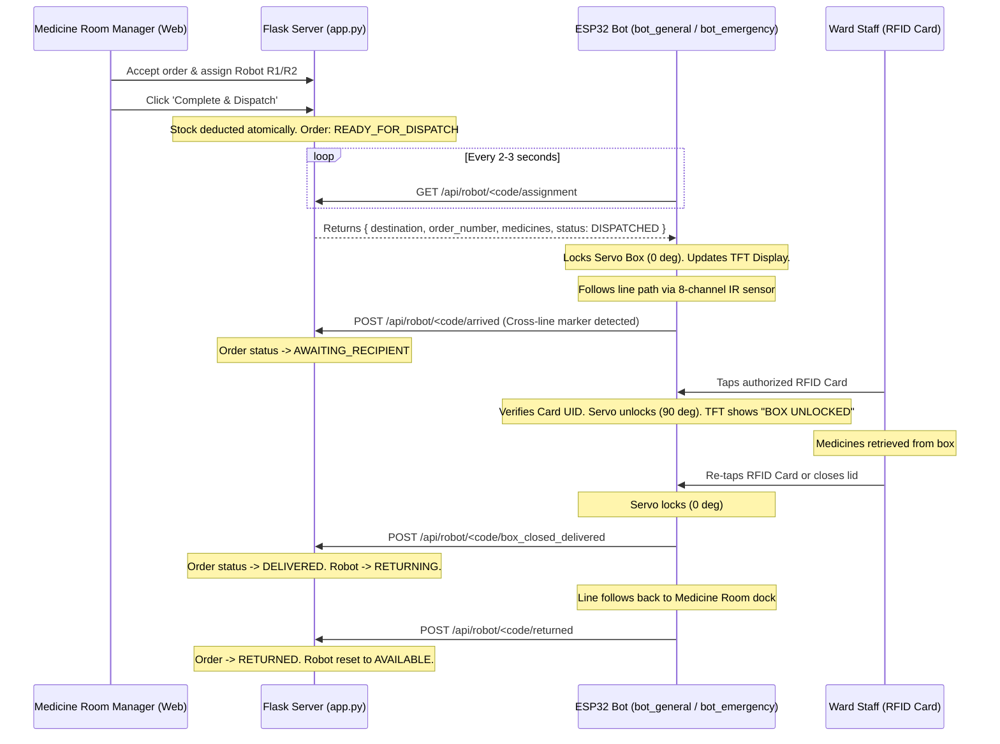

# ESP32 Firmware Guide: Autonomous Hospital Medicine Delivery Robots

This directory contains the complete, unified Arduino C++ firmware for the two hospital medicine transport robots:

1. **[`bot_general.ino`](file:///c:/Users/shubh/Desktop/Techh%20Buddies/2026-27/hospital%20medicine%20transport%20bot/bot_general.ino)** (`R1`): Dedicated robot servicing **General Ward 1** and **General Ward 2**.
2. **[`bot_emergency.ino`](file:///c:/Users/shubh/Desktop/Techh%20Buddies/2026-27/hospital%20medicine%20transport%20bot/bot_emergency.ino)** (`R2`): High-priority robot dedicated to the **Emergency Ward / Operation Theatre** (Priority 1).

---

## 1. Required Arduino IDE Libraries

Install these standard libraries via **Arduino IDE Library Manager** (`Sketch` -> `Include Library` -> `Manage Libraries...`):

- **`Adafruit ILI9341`** by Adafruit (for 2.8" / 2.4" SPI TFT LCD)
- **`Adafruit GFX Library`** by Adafruit (core graphics primitives)
- **`MFRC522`** by GithubCommunity (for RC522 RFID reader)
- **`ESP32Servo`** by Kevin Harrington (for PWM servo box lock control)
- **`ArduinoJson`** (v6 or v7) by Benoît Blanchon (for parsing Flask webhook payloads)

---

## 2. Complete ESP32 Hardware Wiring Reference

### A. Shared SPI Bus (TFT Display + MFRC522 RFID Reader)
Both the ILI9341 display and the RC522 RFID reader share the high-speed hardware VSPI bus on the ESP32. Chip-select pins are toggled automatically in the firmware to prevent bus collisions:

| Signal / Function | ESP32 GPIO | Connected To TFT ILI9341 | Connected To RC522 RFID |
| :--- | :--- | :--- | :--- |
| **SCK (Clock)** | `GPIO 18` | `SCK` | `SCK` |
| **MISO** | `GPIO 19` | `MISO` | `MISO` |
| **MOSI** | `GPIO 23` | `MOSI` | `MOSI` |
| **TFT CS** | `GPIO 21` | `CS` | &mdash; |
| **TFT DC** | `GPIO 22` | `DC` | &mdash; |
| **TFT Reset** | `GPIO 2` | `RESET` | &mdash; |
| **RFID SS / CS** | `GPIO 5` | &mdash; | `SDA / SS` |
| **RFID Reset** | `GPIO 26` | &mdash; | `RST` |
| **Power (3.3V)** | `3V3` | `VCC` | `3.3V` *(Do not connect RC522 to 5V!)* |
| **Ground** | `GND` | `GND` | `GND` |

---

### B. L298N Dual H-Bridge Motor Driver

| L298N Pin | ESP32 GPIO | Description |
| :--- | :--- | :--- |
| **ENA** | `GPIO 3` (RX0) | Left Motor PWM Speed Control |
| **IN1** | `GPIO 17` | Left Motor Direction A |
| **IN2** | `GPIO 16` | Left Motor Direction B |
| **IN3** | `GPIO 14` | Right Motor Direction A |
| **IN4** | `GPIO 12` | Right Motor Direction B |
| **ENB** | `GPIO 1` (TX0) | Right Motor PWM Speed Control |
| **GND** | `GND` | Common Ground with ESP32 & Motor Battery |

---

### C. Servo Cargo Box Lock / Unlock

| Servo Wire | Connection | Description |
| :--- | :--- | :--- |
| **Orange / White (Signal)** | `GPIO 15` | PWM Signal (`45°` = Closed/Locked, `90°` = Open/Unlocked) |
| **Red (Power)** | `5V` (External Battery/BEC) | Power supply (recommended > 1A) |
| **Brown / Black (GND)** | `GND` | Common Ground |

---

### D. 2-Channel IR Line Following Sensors

The robot uses 2 IR sensors mounted at the front undercarriage:

| IR Sensor | ESP32 GPIO | Function |
| :--- | :--- | :--- |
| **Left IR Sensor** | `GPIO 13` | Detects left edge of the line |
| **Right IR Sensor** | `GPIO 27` | Detects right edge of the line |

#### Sensor Calibration & Truth Table:

| Left IR (Pin 13) | Right IR (Pin 27) | Steering Action | Description |
| :---: | :---: | :---: | :--- |
| `0` (Off Line) | `0` (Off Line) | **Move Forward** | Both sensors see surface; robot continues straight along path. |
| `1` (On Line) | `0` (Off Line) | **Turn Left** | Robot drifted right; left motor slows/reverses to center robot. |
| `0` (Off Line) | `1` (On Line) | **Turn Right** | Robot drifted left; right motor slows/reverses to center robot. |
| `1` (On Line) | `1` (On Line) | **STOP (Marker Reached)** | Cross-line detected at destination ward or pharmacy dock! |

*(Note: If your IR sensor module outputs `0` on black and `1` on white, adjust `const int LINE_DETECTED_VAL = 0;` at the top of the sketch to match).*

---

## 3. Configuring WiFi, Server IP & RFID UIDs

At the top of both `.ino` files:

1. **Configure Network & Laptop IP**:
   ```cpp
   const char* WIFI_SSID     = "Your_WiFi_Name";
   const char* WIFI_PASSWORD = "Your_WiFi_Password";

   // IP address of your laptop running Flask (run 'ipconfig' in Windows CMD to find it)
   const char* SERVER_BASE_URL = "http://192.168.1.100:5000";
   ```

2. **Read Your Physical Card UIDs**:
   - Upload the provided RFID test sketch or open Serial Monitor at 115200 baud.
   - Tap each RFID tag/card and copy the 4-byte hex UID.
   - Update in the firmware:
     ```cpp
     // Universal card for Medicine Room Manager (works on BOTH Bot 1 and Bot 2)
     const String CARD_UNIVERSAL_MEDICINE_ROOM = "A1 B2 C3 D4";

     // Ward specific cards:
     const String CARD_GENERAL_WARD_1 = "11 22 33 44";
     const String CARD_GENERAL_WARD_2 = "55 66 77 88";
     const String CARD_EMERGENCY_WARD = "99 88 77 66";
     ```

---

## 4. Operational Webhook Sequence


